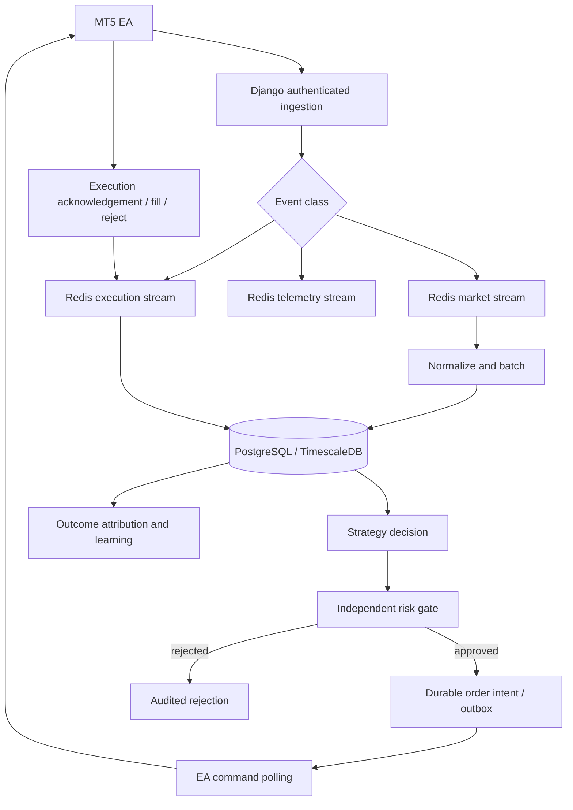

# Ramon Django-native pipeline — overview

## Goal
Move Ramon orchestration into Django in controlled stages while preserving MT5
execution safety. Do not delete legacy `backend/ramon` until parity is demonstrated.

## Invariants
- All timestamps are timezone-aware at boundaries and stored in UTC.
- Every event has an idempotency key; duplicate delivery cannot duplicate side effects.
- Strategy signals never bypass an independent risk gate.
- Persist order intent before exposing it to the EA.
- Reconcile acknowledgements and fills against MT5 broker state.
- Telemetry backlog cannot starve execution-event processing.
- Redis is a recoverable buffer, not the durable source of truth.
- Missing/unhealthy risk policy fails closed.
